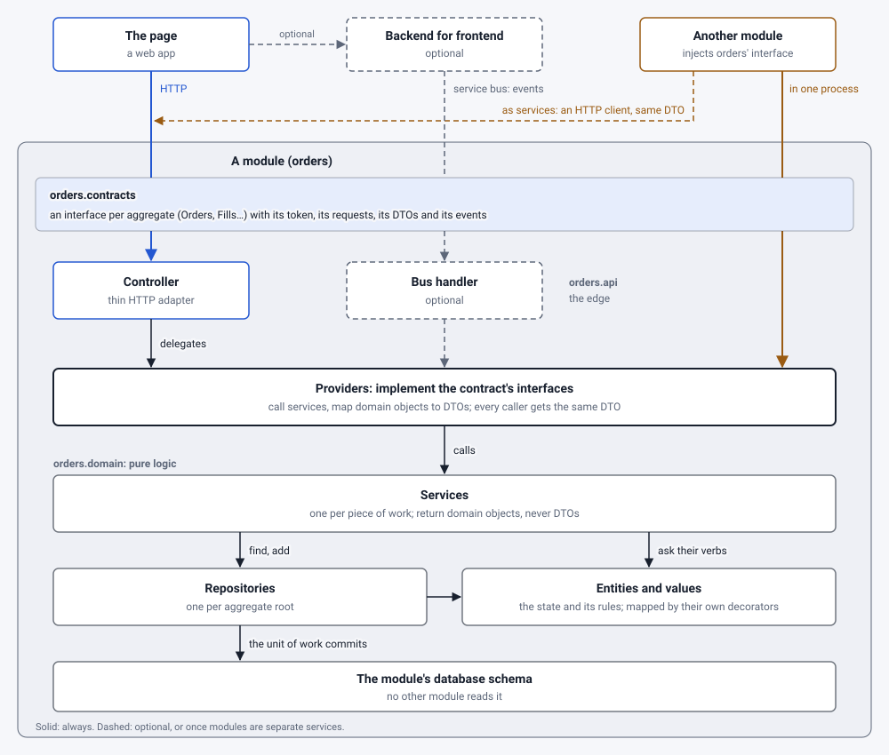

# Modules

How an application is cut into modules, and how they meet. It is domain-driven design kept small: bounded contexts, one owner per fact, contracts between them.

## Cutting modules

- **A module is a bounded context, cut by intent:** where things change apart. Not by technology, and not by the shape of the data.
- **Each fact has one owner.** One module defines each concept and keeps its rules; others use it through that module's contract. If two modules each define an `Order`, one of them is wrong.
- **A module keeps its own data.** It never reads another module's tables, files or internals.

## How modules meet

- **Through contracts.** A module publishes interfaces, tokens, events and the shapes they carry in its `<module>.contracts` package. Other modules import nothing else from it. A contract is plain data in and out, written to travel: today a call may be in-process, later the same contract goes over a service bus, so it never carries a live object.
- **Each shape is declared once, in the contracts.** A request is one class that serves both the controller and the client: it carries the HTTP framework's decorators, which is the one dependency a contracts package may take. Never a type in the contracts and a copy of it at the edge or in a client. The domain's objects and events aren't copies: they are the domain's own, and the api maps them to the contract's shapes.
- **Through events, for what has happened.** The owner's domain raises its event, its api maps it to the contract's event and publishes it, and others subscribe. An event names a fact in the domain's words (`OrderFilled`), never a command in disguise.
- **The consumer's expectations live beside the provider**, as `<consumer>.contract.spec.ts`. A change that breaks a consumer fails in the provider's own tests.

## Inside a module

- **Projects by role.** The domain decides; the api is the edge (controllers, contract providers, migrations, handlers, publishers, running processes and the module's entry) and decides nothing. The api depends on the domain and the contracts; the domain depends on neither: `domain ← api → contracts`.
- **The domain is pure domain logic.** It imports no contract type, neither its own module's requests and answers nor another module's interfaces. What it needs from another module it declares as its own interface, and the api implements that over the other module's contract.
- **Each aggregate's API is an interface in the contracts**, with its token, its request classes, its answers and its events. A **provider** in the api implements it (`<aggregate>.provider.ts`): it calls the domain's services and maps the domain objects they return to the contract's answers. It is the only place that maps, so every caller gets the same answer.
- **Services return domain objects.** A service asks repositories for aggregates and asks the aggregates' verbs. It never returns a wire shape (a date as text, a view).
- **Adapters stay thin.** A controller reads the HTTP request, calls its provider and returns what it gives; it maps nothing. A bus handler does the same for an event.
- **Every caller goes through the interface.** A page calls the controller over HTTP. Another module injects the interface's token: in one process it gets the provider itself; when the modules are separate services it gets an HTTP client implementing the same interface, which calls the controller and gets the same answer. Only that binding changes.
- **Querying another module:** ask it directly through its interface. Keep a copy of its data, fed by its events, only where a read is too hot to ask each time. The bus carries events, not queries.
- **A domain is cut by subdomain first**, then by kind inside each: `entities/`, `values/`, `services/`, `strategies/`, `factories/`, `repositories/`, `errors/`, `testing/`, only the kinds it has.
- **An api is laid out by kind:** `controllers/`, `providers/`, `migrations/`, `handlers/`, `publishers/`, `processes/`, `testing/`, with the module's `.module.ts` and config at its root.
- **One repository per aggregate root**, in the domain. An entity carries its own table mapping, as the ORM's decorators on its class: that is the one outside package a domain may import, and only for that. No second class or schema per table.

## HTTP

- **A controller is one aggregate,** named for it, its routes under its plural noun: `orders.controller.ts` serves `/orders`.
- **Reads and edits are the HTTP verbs** on the resource: `GET`, `POST`, `PATCH`, `DELETE`, and `PUT` to set a value.
- **An operation on one is `POST /<aggregate>/:id/<operation>`** in the domain's word (`/orders/:id/cancel`); one on them all sits on the collection (`POST /orders/pause`). Children stay under their parent (`/orders/:id/fills`).

## One code path

Test, paper and live run the same code. What differs (a venue, a clock, a market) is injected; product code never branches on a mode or an environment.
